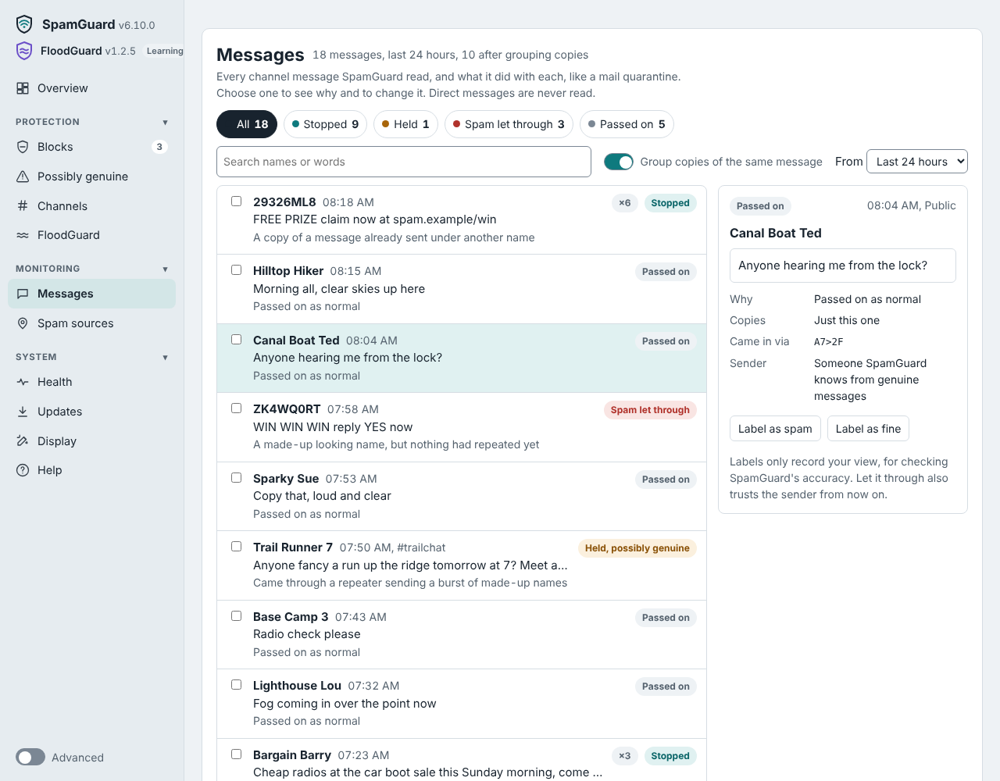
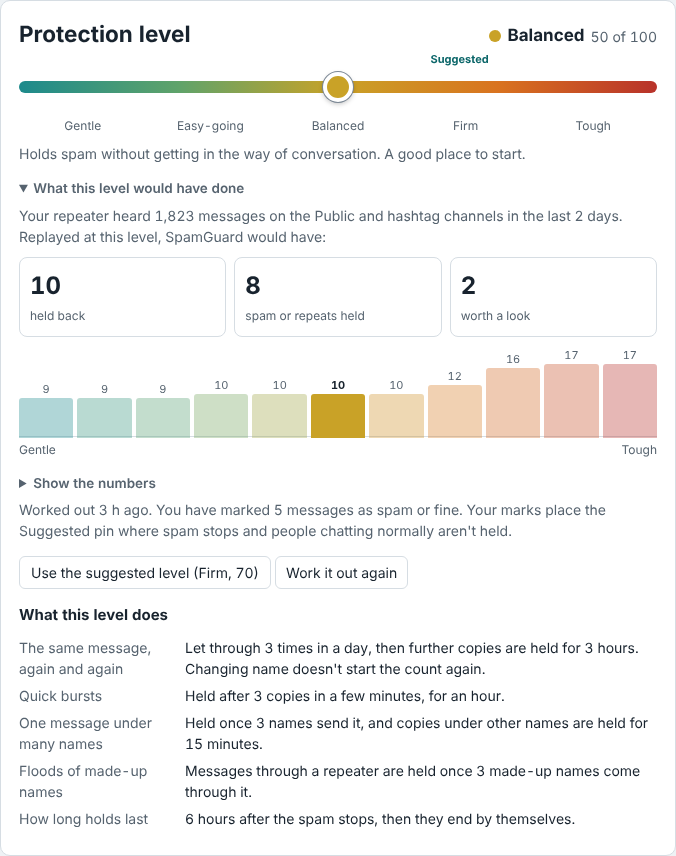

# openHop SpamGuard, with FloodGuard


[](https://www.bestpractices.dev/projects/15768)
[](https://scorecard.dev/viewer/?uri=github.com/flackrat/openhop-spamguard)
[](https://github.com/flackrat/openhop-spamguard/actions/workflows/tests.yml)


> **Spam on your mesh, stopped at the door.** SpamGuard is anti-spam for MeshCore that works things out for itself. Spam floods are spotted as they happen and your repeater stops passing them on, so the rest of the mesh never hears them. There are no block lists to keep up with, and your regulars carry on chatting.
>
> **FloodGuard, inside SpamGuard since 6.0** (it has its own version number, shown next to its name). Some floods aren't channel spam at all. They are encrypted packets with a new identity every time and padded routes, repeated until the mesh is unusable. FloodGuard watches the one thing a flood can't fake, which is how busy your repeater's radio is, and holds back flood packets from far away until the airtime is back to normal. Direct messages are never touched.

SpamGuard runs inside [openHop](https://docs.openhop.dev/) as a plugin. It watches the channel messages and airtime your repeater hears and tells openHop not to pass spam and floods on. What it blocks is spam *behaviour*, never people or opinions.

> ### Quick start: five minutes, the plugin way
> You need a repeater running **openHop 1.1.2 or later** (check under System in openHop's dashboard). This is the recommended way for everyone; you can skip the other install options further down.
>
> 1. **Download** the file ending `-py3-none-any.whl` from the [latest release](https://github.com/flackrat/openhop-spamguard/releases/latest).
> 2. **Install it:** in openHop's dashboard go to **System > Plugins > Install wheel** and choose that file.
> 3. **Make a token:** openHop dashboard > **System > API Tokens** > create one, and copy it.
> 4. **Give SpamGuard the token:** on the Plugins page press **Config** in SpamGuard's row, paste the token into `api_key`, press **Save**, then **Enable**.
> 5. **Open it:** press **Open** in SpamGuard's row. It starts in **Monitor**, which only shows what it *would* stop. After a day, press **Protect** (or let it switch itself once it's sure).
>
> That's it. Updates are one press of **Update** on SpamGuard's page. Stuck? See [the full plugin guide](docs/openhop-plugin.md).

**Useful links:** [found a security problem?](SECURITY.md) · [want to help?](CONTRIBUTING.md) · [the two libraries it uses](requirements.txt) · [what changed, and when](CHANGELOG.md) · [words explained](#new-to-meshcore-how-spam-works-and-the-words-used-here)

## New to MeshCore? How spam works, and the words used here

MeshCore radios pass messages on for each other: a message sent on a **channel** (such as Public) is repeated by every **repeater** that hears it, hop by hop, until it has spread across the mesh. That is what makes the mesh work, and also what makes spam so annoying: one spammer's message, sent once, is carried by every repeater to everyone. Spammers make it worse by using a new made-up name for each message, sending the same text under many names, or flooding the radio with packets until nobody else can get a word in. A repeater can't stop someone sending, but it can refuse to pass something on. That's what SpamGuard does, so the spam stops at your repeater instead of travelling on.

| Word | What it means here |
|---|---|
| **Repeater** | A radio that passes messages on for others. SpamGuard runs on yours. |
| **openHop** | The software that runs a MeshCore repeater on a Raspberry Pi or similar. SpamGuard is a plugin for it. |
| **Channel** | A shared group chat. Public is open to all; hashtag channels such as #chat need only their name; private channels need a key. |
| **Hop** | One radio passing a message to the next. A message that has come 10 hops has been repeated by 10 repeaters. |
| **Route (path)** | The list of repeaters a message came through, shown as short codes such as `27>B1>7E`, read from where it entered the mesh. |
| **Route code (path hash)** | The short code a repeater is known by in a route: the first 2, 4 or 6 characters of its ID. Short codes are shared by many repeaters, which is why working out where spam came from takes some care. |
| **Advert** | A message a repeater sends now and then to say it exists, often with its location. SpamGuard uses adverts to learn which code is which repeater. |
| **Airtime** | How much of the time the radio channel is busy. LoRa radios are slow, so airtime is precious; a flood can use it all up. |
| **Flood packet** | A packet repeated by everyone (most channel messages and adverts). A **direct** message follows a set route instead and isn't touched. |
| **Unscoped** | A flood packet sent without a region. `flood.max.unscoped` is MeshCore's limit on how many hops those may travel; FloodGuard keeps the same kind of limit. |
| **Made-up name / rotating identity** | A spammer using a new random name (such as UD6DWREK) for each message, or a repeater that keeps changing its ID, so it can't simply be blocked by name. |
| **Known people** | Names SpamGuard has seen sending genuine messages. They are let through blocks meant for spam. |
| **Rules (policy)** | openHop's list of what to pass on and what to drop, kept in its `policy.yaml`. SpamGuard adds its own rules there and never changes yours. |
| **Monitor / Protect** | Monitor only shows what SpamGuard would stop; Protect actually stops it. |
| **Protection level** | One slider from Gentle to Tough: how firmly SpamGuard pushes back. |
| **Evidence log** | An optional daily record, kept only on your repeater, of the channel messages SpamGuard read and what it did. It lets you look back over a week and check its decisions. |

**Version numbers.** The release number is SpamGuard's (6.17.0, for example). FloodGuard, the flood protection inside SpamGuard since 6.0, has its own number (such as 1.3.1) that only goes up when FloodGuard itself changes; both come in the same download. openHop is a separate project with its own numbers; SpamGuard needs openHop 1.1.2 or later. The top of the [changelog](CHANGELOG.md) sums up what changed between the big versions.

## Why it's different

Most MeshCore spam tools either hide spam on your own phone, while the mesh still carries it to everyone else, or give repeater owners rules to write and keep up to date by hand. SpamGuard decides for itself, at the repeater, so spam is stopped before it spreads to everyone downstream. SpamGuard learns who your regulars are, so they still get through even when spam arrives the same way. A watch-only mode comes first, showing what it *would* stop before anything is stopped, and any decision can be undone with one press.

## What it does

**SpamGuard: channel spam**
- **Catches spam campaigns:** the same text sent under made-up, rotating names, even when it's disguised.
- **Finds where spam enters the mesh** and blocks it there, while still letting your regulars through.
- **Stops copy-paste floods:** the first copy gets through, copies under other names don't.
- **Stops one name repeating itself:** the same message posted over and over is cut off after a few copies, while anything new from that name still goes out.
- **Stops slow repeating:** the same long message posted again and again through the day, even an hour apart, is cut off after a few copies a day. The first few copies, and anything new from that name, still go out.
- **Stops replays:** a device re-sending other people's old messages (usually broken firmware with a wrong clock or cut-short names) has its further copies held back, while the original and anything new still go out.
- **Lockdown** for a heavy attack: for a while, only people it already knows get through. During a big flood from many repeaters at once it starts by itself, for 15 minutes.

**FloodGuard: the airtime and the radio** (inside SpamGuard since 6.0, with its own version number)
- **Contains floods of any packet type**, including encrypted ones with a new identity every time, by how busy your radio is rather than who sent them. Flood packets that have already come further than your mesh's normal routes aren't passed on while the flood lasts; it tightens a step at a time and lifts by itself. Direct messages and known people's channel messages always get through.
- **Learns your mesh first:** three days of counting only, then it sets its own limits and keeps them in step, a little at a time. Anything you set yourself is kept, and **Reset and learn again** starts afresh.
- **Hop limits like MeshCore's `flood.max.unscoped` and `flood.max.advert`** ([openhop_repeater#426](https://github.com/openhop-dev/openhop_repeater/issues/426)), learnt from your traffic, so padded floods can't run to openHop's 64-hop ceiling.
- **Damaged copies:** counts channel packets whose check fails (a copy changed by radio errors), shows their share of the day's airtime, and keeps them out of the flood share. An optional setting, off by default, stops this repeater passing on damaged Public packets; it needs the openHop rule-check fix.
- **Interference watch:** tells you when something nearby is drowning the channel (equipment that transmits all the time, or jamming), how much hearing range is left, and records each episode with times and levels to pass on.

**Privacy and principles**
- **Wardriving privacy** (off by default): stop the repeater echoing wardriving pings, so it isn't logged on precise coverage maps. Everything else is repeated as normal.
- **Spam, not opinions:** it stops how spam is sent, never what people say. Text blocks never stop people it knows, need a real chunk of a message and last at most a week, and a known person's message can't be marked as spam.
- **Settings profiles:** save tuned settings, put them back later, or share them with other operators as a small file (never your channels, keys or exceptions).
- **Looks after itself:** a simple web page, automatic self-repair, gentle on SD cards, and updates only when you press Update.







_Example data: names and numbers are made up._

## Install

The [quick start](#quick-start-five-minutes-the-plugin-way) at the top is all most people need. This section has the same steps with a little more detail, then the other ways to install for older setups.

**SpamGuard runs as an openHop plugin**, installed from openHop's own dashboard. The plugin works however openHop is installed (directly on a Pi, in Docker, on Unraid or as a Home Assistant add-on) and needs openHop 1.1.2 or later. A Raspberry Pi 3 is plenty; see **Requirements** under Advanced for space, memory and what's been tested.

1. Download `openhop_spamguard-<version>-py3-none-any.whl` from the [latest release](https://github.com/flackrat/openhop-spamguard/releases/latest).
2. In openHop's dashboard go to **System > Plugins > Install wheel** and pick that file.
3. Create an openHop API token (openHop dashboard > System > API Tokens). In SpamGuard's row on the Plugins page press **Config**, paste the token into `api_key`, press **Save**, then press **Enable**.
4. Press **Open** in SpamGuard's row to go to its page (or open `http://<your-repeater>:8091/`). Leave it in **Monitor** for a day (it shows what it *would* stop), then switch to **Protect**. If you don't come back, it switches itself to Protect once it has watched for a day and seen enough spam (the Overview shows when, with a **Stay in Monitor** button).

Full guide, including openHop in Docker: [docs/openhop-plugin.md](docs/openhop-plugin.md). New to openHop? See [docs/openhop-fresh-install.md](docs/openhop-fresh-install.md).

**Already running SpamGuard the older way?** The old version's page offers **Move to the plugin**: one press installs the plugin, carries over your settings, blocks and known people, and switches the old copy off once the plugin has taken over. Only one SpamGuard can look after a repeater at a time, and each copy checks for another before changing anything.

<details>
<summary><b>Other ways to install (older openHop, or a separate container)</b></summary>

**openHop older than 1.1.2, installed directly on a Pi:** update openHop if you can. If not, install SpamGuard as its own service:

```
git clone https://github.com/flackrat/openhop-spamguard.git
cd openhop-spamguard
sudo bash install.sh
sudo sed -i 's/PASTE_OPENHOP_API_TOKEN_HERE/YOUR_TOKEN/' /etc/openhop_spamguard/config.yaml
sudo systemctl start openhop-spamguard
```

Step-by-step guide and troubleshooting: [docs/install-and-troubleshooting.md](docs/install-and-troubleshooting.md). Once openHop is updated, use **Move to the plugin** on SpamGuard's page.

**A separate Docker container** next to openHop: [docs/docker.md](docs/docker.md). The plugin is simpler for most people, as it needs no container of its own.

</details>

## What to expect

SpamGuard learns from your mesh, so it gets better the longer it runs.

- **A few copies of each brand-new spam wave get through** while it confirms it's a campaign. After that the wave is blocked, and if it comes back later it's stopped from the first copy.
- **Your regulars become known** and are always let through. For the first day or two a genuine newcomer is more likely to be held, so open **Messages**, choose **Held**, and press **Let it through** on their message; they're let through straight away.
- **Restarts and updates keep everything it has learnt.**

## Everyday use

| You want to... | Do this |
|---|---|
| Let a genuine person through | Open **Messages**, choose **Held** (or click "Possibly genuine held" on the Overview), then **Let it through** |
| See what SpamGuard stopped, and why | Click **Spam stopped** on the Overview, or open **Messages** |
| Make it gentler or tougher | Slide the **Protection level** on the Overview; open "What this level would have done" to see the effect on your own traffic |
| Stop something it missed | In **Messages**, open it and press **Stop copies like this** |
| Ride out a heavy attack | Press **Lockdown** at the bottom of Blocks (30 min to 2 hours, ends by itself) |
| See where spam comes from | Open **Spam sources** in the menu |
| Pause all blocking | Press **Pause** on the Overview |
| Start over with a clean slate | Advanced > Settings > **Start again from scratch** |
| Clear the charts and spam map | Advanced > Settings > **Clear spam history** |
| Update | Press **Update** when the page says a new version is out |
| Remove it | Plugin: press **Pause**, wait a minute, then uninstall it in openHop (System > Plugins). Older install: `sudo bash /opt/openhop_spamguard/uninstall.sh` |

## What SpamGuard blocks, and what it doesn't

A repeater is shared: anything it refuses to pass on disappears for everyone downstream, and they can't see why. So SpamGuard judges **behaviour, never opinions or people**.

- **SpamGuard blocks:** the same text sent under several names, made-up or disguised names, floods of repeats (including one name posting the same message again and again), and repeaters injecting spam campaigns.
- **FloodGuard looks only at how packets travel:** flood or direct, how many hops they've come, and how busy the radio is. Never at who sent them or what they say, and only while a flood is actually swamping the airtime.
- **SpamGuard doesn't block** what someone says, or a named person for their views. Even the repeat guard only holds back *further copies of the repeated message*, for an hour; anything new that person says still goes out.
- **Blocking a particular person is your app's job, not the repeater's.** There's deliberately no "block this person" button. MeshCore apps and sites let each user block or hide a sender, repeater or channel for themselves. Blocking there only changes what *you* see, and the mesh still carries the message, so it's the right place for "I don't want to read this person". SpamGuard deals with behaviour that harms everyone's channel, at the repeater, so it never travels further.
- **There is no under-18 mode**, because a repeater can't tell anyone's age and a language filter wouldn't catch the real risks. [Protecting young people on MeshCore](docs/protecting-young-people.md) explains what works better, including a private channel for a youth group.
- **"This is spam" and text blocks are for spam content**, not for silencing a point of view. Every automatic block expires once the spam stops.

## Advanced

Click a heading to expand it.

<details>
<summary><b>The web page</b></summary>

- **Menu**: a side menu like openHop's own (a slide-out menu on phones), with SpamGuard's and FloodGuard's versions at the top and FloodGuard's state (Learning, On, Flood, Off) next to its name. **Overview**, **Protection** (blocks with the emergency Lockdown, possibly genuine, channels with the wardriving option, FloodGuard), **Monitoring** (messages, spam sources) and **System** (health, updates, help).
- **FloodGuard page**: what it's doing now and what it has learnt, flood packets per hour, how busy the radio was, interference on the channel with recorded episodes, its off switch, and (in Advanced) its settings. Advanced adds campaigns, activity, settings (in collapsible groups with a search box), exceptions and the evidence log.
- **Overview**: mode, the protection level slider (with what each level would have held on your own traffic), and the numbers at a glance: spam stopped, let through, spam's share of channel traffic, airtime saved, genuine messages held, known people. Charts show the last 24 hours, the last 7 days, and which hours of the day spam usually arrives, with a switch to show FloodGuard's flood packets alongside.
- **Messages**: every channel message in one quarantine list, filtered by what SpamGuard did (stopped, held for review, spam let through, passed on), with copies grouped, a search box, the reason for each, and Let through, Stop copies like this and label buttons. The Overview's numbers open it already filtered.
- **Spam sources**: where spam enters the mesh, on a map and in a table with Block / Never block buttons. A repeat spammer heard through several repeaters is shown as one sender, and circles can be sized by messages or senders. SpamGuard works out where each spam message most likely entered the mesh, learning from repeater adverts as it goes, so short repeater codes shared around the country don't scatter the map; it can optionally use the public MeshCore map to place far-away repeaters. By default the map only shows entry points it is sure of; tick "Show best guesses too" to add the rough ones. The map needs internet access on the device viewing the page; the table works without it.
- **Long lists** (messages, blocks, activity) show 10 at a time with **Show more**.
- **Advanced** (switch at the bottom of the menu): every setting with what it does and a "Watch out" note on its side-effects, per-block controls, per-repeater statistics, spam campaigns, exceptions (trusted senders, the known people list with Trust and Forget, repeaters and texts never blocked), settings profiles, the evidence log and an activity log. Channels have their own page in the menu.

</details>

<details>
<summary><b>Known people, links and Lockdown</b></summary>

SpamGuard keeps a list of names it has seen sending genuine messages. The list goes into openHop as a policy object, `@spamguard.known_senders`, with one "let known people through" rule, placed after your own rules. The blocks below that rule never stop a known name:

- **Repeater blocks** block *anything passing through* the spam repeater, except known people, and end a while after the spam through it stops (Advanced > Timing). People held this way who don't look like spammers are listed under **Possibly genuine, held** on the main page, with a **Let through** button. The older "Routes starting there" and "Anything passing through" choices are still in Advanced.
- **Route blocks you add yourself** hold messages whose first repeaters are the ones you give, in that order (for example `27>B1`), for spam that always starts the same way. They are much narrower than blocking the first repeater, and known people still get through. Add one in Blocks, or with **Block route** on a spam message in Messages. Until openHop can check the order of a route, your repeater holds any message that passes through all of them.
- **Suggested route blocks.** When many brand-new names suddenly start on the same first two repeaters, Blocks suggests blocking that route, with **Block it** and **Not now**. It looks at names, routes and timing only, never at what a message says, and nothing happens until you press the button. How quick it is follows the protection level. An optional setting, off by default, lets SpamGuard apply it for you, for a limited time and at most three at once.
- **Narrower automatic blocks.** When the only sign against a repeater is brand-new names and nearly all of them started on one route, SpamGuard blocks just that route rather than everything through the repeater. Made-up names and spam campaigns still block the whole repeater.
- **Floods that aren't channel text.** When one first repeater (or up to four together) sends most of the flooded requests, anonymous requests or group data your repeater hears, Blocks suggests holding that kind of packet from that repeater for a while, with **Hold them** and **Not now**. These packets are encrypted, so only counts, routes and timing are used; channel and direct messages are never held by this. How quick it is follows the protection level. An optional setting, off by default, applies it for you, at most three at once.
- **Signed messages (optional).** When turned on in Settings, SpamGuard counts signed channel messages, checks each signature against the sender's advertised key, and shows the totals and the airtime they use on the Overview. It can suggest trusting a known person's key, so a copy of their name can't borrow their trust. It never holds anything back for being signed or unsigned, and keeps only counts and short key ids.
- **Links from names it doesn't know** are held while a spam campaign is under way. Advanced > Known people can make this always or never.
- **Text blocks you add yourself** only ever stop names SpamGuard doesn't know yet.
- **Lockdown** (at the bottom of the Blocks page): for 30 minutes to 2 hours, only known names get through on the channels SpamGuard reads. New people are held too, so it's for heavy attacks only. The lockdown ends by itself. During a big flood from many repeaters at once SpamGuard starts a 15-minute lockdown itself (Advanced > Blocking by source repeater can turn that off).

Things to know:

- How quickly a name becomes known is adjustable (Advanced > Known people), and Advanced > Exceptions lists everyone it knows, with **Trust** and **Forget**. Automatic campaign blocks apply to everyone, because spammers copy known names, but one that keeps catching regulars heard from their usual repeater removes itself.
- Names are forgotten after a long silence. The list is in openHop's `policy.yaml`; channel names are public anyway, but bear it in mind if you share that file.

</details>

<details>
<summary><b>Health and self-repair</b></summary>

The **Health** panel on the page shows whether SpamGuard is working: how long it has been running, when it last checked, whether openHop is answering, whether all its rules are in place in openHop, and how many times it has restarted. Advanced adds the Pi's temperature, memory, disk and load.

SpamGuard looks after itself:
- **Restarts if it hangs or crashes.** As a plugin (or in Docker) it watches its own checking loop and quits if it ever gets stuck, and openHop (or Docker) starts it again. The older install checks in with systemd after every pass instead, and systemd restarts it if it stops checking in for 90 seconds.
- **Puts its rules back.** Once a minute it confirms openHop still has exactly its rules (after an openHop restart, restore or manual edit), and restores them if not. Your own rules are never touched.
- **Keeps protecting while down.** The rules live in openHop, so blocking carries on even if SpamGuard is stopped. Blocks just don't expire or update until it's back.
- **Measures openHop's delay.** The page shows how far behind real time openHop's packet list is and warns when it is 30 seconds or more behind, because spam copies arriving in that gap get through before a block starts. Each evidence-log line also records how late SpamGuard saw the message.
- **Notices a deaf radio.** If openHop reports no new packets of any kind for 20 minutes, the Health panel warns that its radio may have stopped receiving.
- **Asks openHop for as little as possible.** SpamGuard reads only packets newer than the last ones it saw, using a query openHop's database answers from its time index (older openHop versions fall back to the recent packet list).
- **Warns early.** Health warns when the disk has under 200 MB free, memory is under 10% free, the Pi reaches 70 °C (a problem at 80 °C), a check takes longer than the gap between checks, talking to openHop fails 20 or more times in an hour, or openHop's repeater service isn't running.

As a plugin, openHop's **System > Plugins** page shows whether SpamGuard is running, with a **Logs** button. On the older install, quick checks from the command line:
```
systemctl is-active openhop-spamguard          # "active" = running
curl -s http://127.0.0.1:8091/health           # "state": "ok" / "warn" / "bad"
systemctl show openhop-spamguard -p NRestarts  # how many times systemd has restarted it
```
`/health` returns HTTP 200 when healthy and 503 when something is wrong, so it can be watched by a monitoring tool such as Uptime Kuma.

</details>

<details>
<summary><b>openHop running behind</b></summary>

Most repeaters never see this. If the Health panel shows **openHop delay** in minutes rather than seconds, openHop is struggling to save the packets it hears (usually an older Pi with a large packet history), so SpamGuard sees spam late. Health then suggests a fix to run. Keeping 7 days of packet history instead of 31 also helps: see [docs/openhop-fresh-install.md](docs/openhop-fresh-install.md).

</details>

<details>
<summary><b>Blocked spam still getting through (openHop rule-check fix)</b></summary>

openHop's rule checker has a bug that can mix up one channel message with an earlier one, so spam a rule should stop is sometimes passed on, or a genuine message dropped.

SpamGuard has a one-line fix for it, which keeps a copy of openHop's original file. On the older install it applies the fix automatically and puts it back if an openHop update removes it (turn that off under Advanced > Settings > Updates). A plugin can't change openHop's own files, so as a plugin the Health page tells you when the fix is missing and gives the one command to run on the Pi. If openHop itself runs in Docker the fix can't be applied, and openHop's own fix is the cure. `sudo bash tune-openhop.sh --undo` removes it. The bug has been reported to openHop ([#520](https://github.com/openhop-dev/openhop_repeater/issues/520)); once their own fix is released, SpamGuard sees it isn't needed and the Health page recommends updating openHop instead.

SpamGuard also reads openHop's own record of what happened to each message, so any spam openHop passes on despite a block is counted as let through, and the Overview says so.

</details>

<details>
<summary><b>Updating</b></summary>

SpamGuard looks for a new release once a day (you can turn that off in Advanced > Updates) and shows it in the **Updates** section of its page, with what's new. Nothing is installed until you press **Update**, and your settings, blocks and learnt routes are kept.

As a plugin, **Update** fetches the new plugin file, hands it to openHop and openHop restarts SpamGuard on it. In Docker, run `docker compose pull && docker compose up -d`. On the older install, if the new version doesn't start, the previous one is put back automatically; from the command line:

```
sudo bash /opt/openhop_spamguard/update.sh --check          # installed and latest versions
sudo bash /opt/openhop_spamguard/update.sh                  # install the latest release
sudo bash /opt/openhop_spamguard/update.sh --version v5.9   # install a particular release (also to go back)
```

Or, from your clone: `git pull && sudo bash install.sh`.

**If a plugin update stops, or SpamGuard disappears from openHop's Plugins page.** Before it changes anything, the Update button checks that the new version's libraries (PyYAML and pycryptodome) can be installed from ready-made builds on your machine. If they can't, it stops and says so, with nothing removed, and offers **Update anyway**. The check matters on a Raspberry Pi 3 (or any small Pi), because openHop would otherwise compile the library from source, which can take longer than openHop waits. If that is cut short, the old version is already gone and SpamGuard stays uninstalled until you add it again. To get it back, download `openhop_spamguard-<version>-py3-none-any.whl` from the [latest release](https://github.com/flackrat/openhop-spamguard/releases/latest) and upload it on openHop's **Plugins** page. Your settings and everything learnt are kept in the plugin's data folder and come back with it. From 6.5.5 the plugin asks for PyYAML the way its published files spell it, which avoids the compile on Raspberry Pi OS Bookworm (pip 23.0 otherwise rejects the ready-made build over the capital letters).

How the button works: SpamGuard runs as an ordinary user, so it can't install software. Pressing Update leaves a request file that a small root-owned systemd service (`openhop-spamguard-update`) carries out. It only ever downloads tagged releases of this repository over HTTPS. Changes are listed in [CHANGELOG.md](CHANGELOG.md).

</details>

<details>
<summary><b>Uninstalling</b></summary>

**Plugin:** on SpamGuard's page press **Pause** and wait a minute (that takes its rules back out of openHop), then uninstall it in openHop under System > Plugins. The plugin's data folder goes with it unless you keep it.

**Older install:**

```
sudo bash /opt/openhop_spamguard/uninstall.sh
```

The script stops SpamGuard, takes its blocking rules (names starting `spamguard:`) back out of openHop, and removes its program, config, data and services. openHop, its settings and any rules you made yourself are left alone.

- `--keep-evidence` keeps the evidence log in `/var/lib/openhop_spamguard/evidence`.
- `--undo-speed-fix` also puts openHop's original packet-count setting back. Otherwise the speed fix stays, as it only makes openHop faster.
- If you chose 7 days of packet history at install, openHop keeps that. To go back to its default, set `sqlite_cleanup_days: 31` in `/etc/openhop_repeater/config.yaml` and restart openHop.

On versions before 5.8.3, which don't have `uninstall.sh`, run it from a fresh download:

```
git clone https://github.com/flackrat/openhop-spamguard.git /tmp/sg && sudo bash /tmp/sg/uninstall.sh
```

</details>

<details>
<summary><b>Evidence log and replay</b></summary>

Switch on **Keep an evidence log** in Advanced > Detection settings. SpamGuard then writes one line per channel message to `/var/lib/openhop_spamguard/evidence/` (one file per day, kept 7 days by default). Each line records the route, sender, text, every spam signal, which rule caught it, and your **This is spam** / **Not spam** answers. Block changes and settings are recorded too. A restart never writes the same message into the log twice.

Download it from Advanced > Evidence log. **Names scrambled** replaces every name and @mention with a code (keeping its spam score and shape), so it can be shared safely.

Replay a log with different settings to see what would have been caught, missed or wrongly blocked. On the older install it's already on the Pi; otherwise use a copy of this repository (`python3 replay.py ...`, with `pycryptodome` and `pyyaml` installed):
```
/opt/openhop_repeater/venv/bin/python /opt/openhop_spamguard/replay.py spamguard-evidence.jsonl --details
/opt/openhop_repeater/venv/bin/python /opt/openhop_spamguard/replay.py spamguard-evidence.jsonl --set dedupe_seconds=600
```
The more messages you label with the two buttons, the more useful the replay report is.

</details>

<details>
<summary><b>Rotating-identity protection</b></summary>

- The protection needs history: SpamGuard learns normal routes as it runs (kept for 7 days by default). Right after installing, few repeaters are "known", so a rotation block may also hold back a genuine new repeater on that route until you allow it.
- The protection only triggers on strong spam signs, never on ordinary traffic from new repeaters, and never blocks a route that people who've been chatting for a while depend on.
- The rules are placed after your own openHop rules, so the "let through" exceptions never override anything you set up.
- Because of what openHop's rules can express, a rotation block can occasionally hold back a genuine message on a similar route. Anything that looks genuine shows under **Possibly genuine** with a **Let through** button.

</details>

<details>
<summary><b>Requirements and tested systems</b></summary>

- **Plugin (recommended):** openHop 1.1.2 or later with its plugin manager running, however openHop is installed. **Older install:** openHop installed natively on Debian-style Linux with systemd, plus `curl` for updates (both standard on Raspberry Pi OS). **Docker:** any host running openHop in Docker; images for 64-bit and 32-bit Pi and for PCs (see [docs/docker.md](docs/docker.md)).
- **Hardware:** a Raspberry Pi 3 or better. A Pi Zero 2 W should cope but hasn't been tested.
- **Software:** Python 3.9 or newer, which openHop already provides. The only libraries are pycryptodome and PyYAML, which openHop already uses. No internet needed apart from the optional update check and map directory.
- **Space:** about 125 KB to download and under 1 MB installed. The working file (about 150 KB) is saved at most every 5 minutes unless something important changes, about 33 MB of writes a day; openHop's own packet database writes far more, which is why the installer offers to keep 7 days of packet history. The evidence log is off unless you turn it on, then about 1 to 3 MB a day kept 7 days (allow 10 to 20 MB). Everything else it remembers is capped and forgotten after a while. A "High Endurance" or A2 SD card is a good idea for any always-on Pi.
- **Memory and CPU:** about 50 MB of memory at its busiest in a three-hour attack simulation, a few milliseconds per check, at most about one check a second however busy the mesh gets. The older install runs at lower priority than openHop, with memory limits of 250 MB (soft) and 400 MB (hard).
- **Limits on what it writes into openHop:** "Most rules at once" defaults to 300 and can't go above 500, covering every rule SpamGuard writes. Text blocks last at most a week; your own rules are never changed.
- **Tested** on Raspberry Pi OS (32-bit, Pi 3) in daily use, as the older install and as the plugin on openHop 1.1.5, and with openHop 1.1.5 on Ubuntu 24.04 (x86_64) as the plugin, the older install moved to the plugin, and a Docker container. Python 3.10 to 3.13. Works with 1-, 2- and 3-byte path hashes and with hashtag channels (add them on the Channels page).

</details>

<details>
<summary><b>Limits</b></summary>

SpamGuard only controls what **your** repeater forwards. People within range of the spammer will still hear them, so the more repeaters near the source that filter, the better. SpamGuard can't read private channels or direct messages unless you add the channel key.

**Repeater blocks match the repeater anywhere on a message's route.** openHop's rules can't yet say "this message *started* at repeater X", only "repeater X appears somewhere in its route". So a genuine message that merely passes through a blocked repeater, or comes from another repeater sharing its short code, can be held too. SpamGuard softens this by letting known people through, ending repeater blocks soon after the spam stops, and listing anything that looks genuine under **Possibly genuine** with a **Let through** button. A first-hop field that would fix this properly has been requested from openHop in [issue #519](https://github.com/openhop-dev/openhop_repeater/issues/519); a 👍 there helps. SpamGuard will use the field once openHop has it.

</details>

## Accessibility

The web page is built to WCAG 2.1 AA and works fully with a keyboard and screen readers. The **Display** page in the menu lets each person choose larger text, light or dark colours, high contrast and reduced motion; those choices are saved in their own browser. Every chart has a table of its numbers, and the spam map's circles can be reached with Tab and opened with Enter. If something doesn't work for you, please open an issue.

## For developers

SpamGuard needs only two libraries, [pinned in `requirements.txt`](requirements.txt) with checksums: pycryptodome (to read channel messages) and PyYAML (to read its config file). The tools for tests and checks have their own locked lists in `requirements/`. To report a security problem privately, see [SECURITY.md](SECURITY.md); to suggest or send a change, see [CONTRIBUTING.md](CONTRIBUTING.md).

`bash tests/run_all.sh` runs the test suite against a fake openHop and openHop's real rule engine (add `--slow` for the Pi-sized stress test). The suite includes `tests/redteam.py`, a simulated four hours of chat and fourteen kinds of spam attack that fails if too much spam gets through or too many genuine messages are held; nothing in it talks to a real repeater, and all its data is made up. The whole suite, plus a lint, a privacy check and a dependency review, [runs automatically on GitHub](https://github.com/flackrat/openhop-spamguard/actions/workflows/tests.yml) for every pull request and every change to `main`, and `main` only accepts changes through a pull request whose tests have passed, so nothing reaches a release untested. `tools/fieldcheck.js` is a read-only self-check you can paste into the browser console with the SpamGuard page open: it summarises the last 12 hours from SpamGuard's own status and evidence log (whether it stayed up, whether any blocked spam was forwarded or any genuine message dropped, and what the spam map shows). The script only ever reads the log with names scrambled, and never the lists of people in the status.

## Other openHop plugins

SpamGuard is one of a growing number of plugins for openHop Repeater. Others worth a look:

| Plugin | What it does |
|---|---|
| [txmesh](https://github.com/zfouts/openhop-txmesh-plugin) | Connects your repeater to the txme.sh network, reporting mesh activity and relaying bot replies |
| [Telemetry](https://codeberg.org/vanous/openhop-telemetry-plugin) | Collects voltage and temperature from MeshCore repeaters |
| [Prometheus](https://github.com/openhop-dev/openhop-prometheus-plugin) | Exports your repeater's telemetry as Prometheus metrics, with a small built-in dashboard |
| [Nomad](https://github.com/openhop-dev/openhop-nomad-plugin) | Bridges a dedicated repeater companion identity to Project N.O.M.A.D. |

Know another one? Suggestions are welcome as an issue.

## Licence

GNU Affero General Public License v3.0 or later (AGPL-3.0-or-later), see [LICENSE](LICENSE). Copyright (c) 2026 Flackrat.

You're free to use, study, change and share SpamGuard. If you share a copy or a changed version, or let people use a changed version over a network (for example as a web page), you must make its full source code available under the same licence and keep the copyright notice. Versions up to 5.32 were released under the MIT licence; from 5.33 on SpamGuard is AGPL. Changes are listed in [CHANGELOG.md](CHANGELOG.md).

## Disclaimer

- **No warranty.** SpamGuard is provided "as is", without warranty of any kind, express or implied. To the extent permitted by law, the author and contributors accept no liability for any loss or damage arising from its use, including missed spam, genuine messages being blocked, repeater downtime or data loss. See the licence (AGPL-3.0, sections 15 and 16) for the full terms. Nothing in this disclaimer limits any liability that cannot be limited by law.
- **You run it, you decide.** SpamGuard changes what your own repeater forwards. You choose its mode and settings and you are responsible for how you operate your repeater. Start in Monitor mode and check what it would block.
- **Radio rules.** SpamGuard doesn't transmit or change radio settings, but the repeater it runs alongside must be operated within the rules for your country and band (in the UK, Ofcom's licence-exempt short-range device rules). Compliance is the operator's responsibility.
- **Personal data.** SpamGuard reads Public and hashtag channel messages your repeater receives, which anyone with a MeshCore device can read. Recent messages, sender names and routes are kept in memory and, only if you switch the evidence log on, in files on your own Pi (7 days by default). Nothing is sent anywhere except the optional once-a-day version check to GitHub, the download from GitHub when you press Update, and, only if you turn it on, a once-a-day download of the public MeshCore map's repeater list. If you keep or share logs, you are responsible for complying with data-protection law where you are (for example the UK GDPR); use the "names scrambled" export when sharing.
- **Changes to openHop.** The optional `tune-openhop.sh` edits one setting inside your openHop installation, with your consent and a backup. Use it at your own risk; it can be undone with `--undo`.
- **Independent project.** SpamGuard is not affiliated with, endorsed by or supported by openHop, MeshCore or their developers. Product names are used only to describe compatibility and belong to their respective owners.
- **Not professional advice.** The documentation describes how the author set things up; it isn't legal, regulatory or professional advice.
