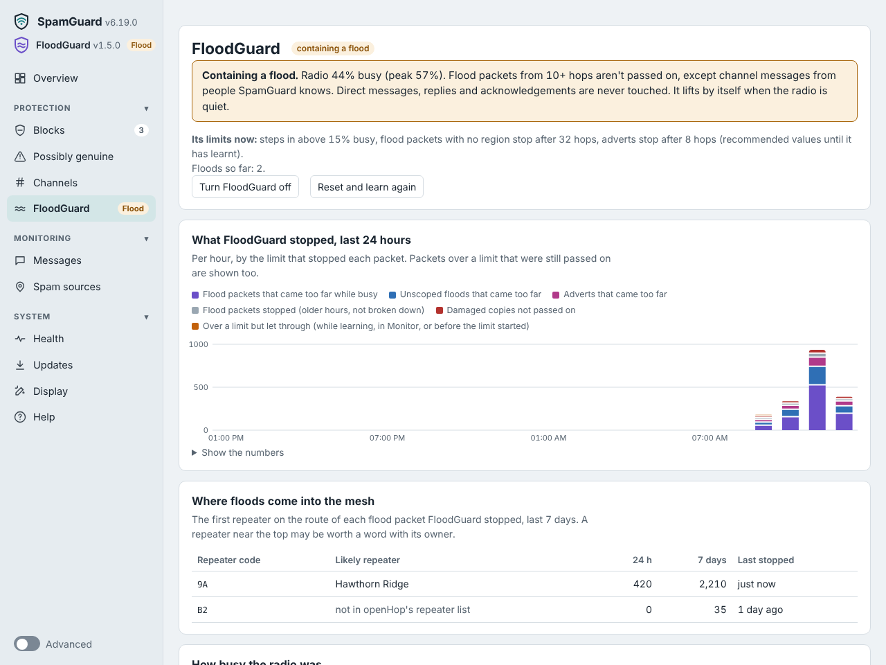

# openHop SpamGuard


> **Spam on your mesh, stopped at the door.** SpamGuard is anti-spam for MeshCore that works it out for itself. It spots spam floods as they happen and stops your repeater passing them on, so the rest of the mesh never hears them. No block lists to keep up, and your regulars keep chatting.
>
> **FloodGuard, inside SpamGuard since 6.0** (it has its own version number, shown next to its name). Some floods aren't channel spam at all, just encrypted packets with a new identity every time and padded routes, repeated until the mesh is unusable. FloodGuard watches the one thing a flood can't fake, how busy your repeater's radio is, and holds back flood packets from far away until the airtime is back to normal. Direct messages are never touched.

It runs inside [openHop](https://docs.openhop.dev/) as a plugin, watches the channel messages and airtime your repeater hears, and tells openHop not to pass spam and floods on. It blocks spam *behaviour*, never people or opinions.

## Why it's different

Most MeshCore spam tools either hide spam on your own phone, while the mesh still carries it to everyone else, or give repeater owners rules to write and keep up to date by hand. SpamGuard decides for itself, at the repeater, so spam is stopped before it spreads to everyone downstream. It learns who your regulars are, so they still get through even when spam arrives the same way. It starts in a watch-only mode that shows what it *would* stop before it stops anything, and any decision can be undone with one press.

## What it does

- **Catches spam campaigns:** the same text sent under made-up, rotating names, even when it's disguised.
- **Finds where spam enters the mesh** and blocks it there, while still letting your regulars through.
- **Stops copy-paste floods:** the first copy gets through, copies under other names don't.
- **Stops one name repeating itself:** the same message posted over and over is cut off after a few copies, while anything new from that name still goes out.
- **Stops replays:** a device re-sending other people's old messages (usually broken firmware with a wrong clock or cut-short names) has its further copies held back, while the original message and anything new still go out.
- **Lockdown** for a heavy attack: for a while, only people it already knows get through. It starts by itself for 15 minutes during a big flood from many repeaters at once.
- **FloodGuard (new in 6.0, on by default from 6.1):** contains floods of any packet type by airtime, not identity. When flood traffic keeps the radio too busy, flood packets that have already come further than this mesh's normal routes aren't passed on, tightening a step at a time and lifting by itself when the radio is quiet. Known people's channel messages and all direct (routed) traffic still get through. It spends its first three days learning how busy your radio normally gets and how far packets normally travel (only counting meanwhile), then sets its own limits and keeps them in step with your mesh; anything you set yourself is kept. It has its own page, with an off switch and a reset that learns afresh, with a chart of how busy the radio was, and the flood packets it stops can be shown on the same Overview graphs as the spam, in their own colour.
- **Interference watch (FloodGuard 1.2):** learns this site's normal noise on the channel from openHop's measurements and tells you, on its page, on Health and in Activity, when something nearby is drowning it, such as equipment that transmits all the time or jamming. It shows how much hearing range is left and records each episode with times and levels to pass on to whoever can fix it.
- **Hop limits like MeshCore's `flood.max.unscoped` and `flood.max.advert`** for openHop ([openhop_repeater#426](https://github.com/openhop-dev/openhop_repeater/issues/426)): learnt from your own traffic (unscoped flood packets between 16 and 32 hops, adverts between 6 and 16, starting from 32 and 8), which stops padded floods running to openHop's 64-hop ceiling. Both can be changed or turned off.
- **Wardriving privacy (new in 6.2, off by default):** stop this repeater echoing wardriving pings (MeshMapper's `#wardriving` channel), so it isn't logged on precise coverage maps. Everything else is repeated as normal, and your own companions' pings still go out. It helps keep the repeater's exact location private; it doesn't hide it from direction-finding, adverts or route logs.
- **Wardriving privacy (new in 6.2, off by default):** stop this repeater echoing wardriving pings (MeshMapper's `#wardriving` channel), so it isn't logged on precise coverage maps. Everything else is repeated as normal, and your own companions' pings still go out. It helps keep the repeater's exact location private; it doesn't hide it from direction-finding, adverts or route logs.
- **Settings profiles:** save a set of tuned settings, put it back later, or share it with other operators as a small file (never your channels, keys or exceptions).
- **Spam, not opinions:** it stops how spam is sent, never what people say. Text blocks never stop people it knows, need a real chunk of a message (not a word or a name) and last at most a week, and a known person's message can't be marked as spam.
- **Looks after itself:** a simple web page, automatic self-repair, gentle on SD cards, and updates only when you press Update.





_Example data: names and numbers are made up._

## Install

**SpamGuard runs as an openHop plugin**, installed from openHop's own dashboard. That works however openHop is installed (directly on a Pi, in Docker, on Unraid or as a Home Assistant add-on) and needs openHop 1.1.2 or later. A Raspberry Pi 3 is plenty; see **Requirements** under Advanced for space, memory and what's been tested.

1. Download `openhop_spamguard-<version>-py3-none-any.whl` from the [latest release](https://github.com/flackrat/openhop-spamguard/releases/latest).
2. In openHop's dashboard go to **System > Plugins > Install wheel** and pick that file.
3. Create an openHop API token (openHop dashboard > System > API Tokens). In SpamGuard's row on the Plugins page press **Config**, paste the token into `api_key`, press **Save**, then press **Enable**.
4. Press **Open** in SpamGuard's row to go to its page (or open `http://<your-repeater>:8091/`). Leave it in **Monitor** for a day (it shows what it *would* stop), then switch to **Protect**. If you don't come back, it switches itself to Protect once it has watched for a day and seen enough spam (the Overview shows when, with a **Stay in Monitor** button).

Full guide, including openHop in Docker: [docs/openhop-plugin.md](docs/openhop-plugin.md). New to openHop? See [docs/openhop-fresh-install.md](docs/openhop-fresh-install.md).

**Already running SpamGuard the older way?** Its page offers **Move to the plugin**: one press installs the plugin, carries over your settings, blocks and known people, and switches the old copy off once the plugin has taken over. Only one SpamGuard can look after a repeater at a time, and each copy checks for another before changing anything.

<details>
<summary><b>Other ways to install (older openHop, or a separate container)</b></summary>

**openHop older than 1.1.2, installed directly on a Pi:** update openHop if you can. If not, install SpamGuard as its own service:

```
git clone https://github.com/flackrat/openhop-spamguard.git
cd openhop-spamguard
sudo bash install.sh
sudo sed -i 's/PASTE_OPENHOP_API_TOKEN_HERE/YOUR_TOKEN/' /etc/openhop_spamguard/config.yaml
sudo systemctl start openhop-spamguard
```

Step-by-step guide and troubleshooting: [docs/install-and-troubleshooting.md](docs/install-and-troubleshooting.md). Once openHop is updated, use **Move to the plugin** on SpamGuard's page.

**A separate Docker container** next to openHop: [docs/docker.md](docs/docker.md). The plugin is simpler for most people, as it needs no container of its own.

</details>

## What to expect

SpamGuard learns from your mesh, so it gets better the longer it runs.

- **A few copies of each brand-new spam wave get through** while it confirms it's a campaign. After that the wave is blocked, and if it comes back later it's stopped from the first copy.
- **It gets to know your regulars** and always lets them through. For the first day or two a genuine newcomer is more likely to be held: press **Not spam** on their message and they're let through straight away.
- **Restarts and updates keep everything it has learnt.**

## Everyday use

| You want to... | Do this |
|---|---|
| Let a genuine person through | Press **Let through** under "Possibly genuine, held", or **Not spam** on their message |
| Stop something it missed | Press **This is spam** on the message |
| Ride out a heavy attack | Press **Lockdown** at the bottom of Blocks (30 min to 2 hours, ends by itself) |
| See where spam comes from | Open **Spam sources** in the menu |
| Pause all blocking | Press **Pause** on the Overview |
| Start over with a clean slate | Advanced > Settings > **Start again from scratch** |
| Clear the charts and spam map | Advanced > Settings > **Clear spam history** |
| Update | Press **Update** when the page says a new version is out |
| Remove it | Plugin: press **Pause**, wait a minute, then uninstall it in openHop (System > Plugins). Older install: `sudo bash /opt/openhop_spamguard/uninstall.sh` |

## What SpamGuard blocks, and what it doesn't

A repeater is shared: anything it refuses to pass on disappears for everyone downstream, and they can't see why. So SpamGuard judges **behaviour, never opinions or people**.

- **It blocks:** the same text sent under several names, made-up or disguised names, floods of repeats (including one name posting the same message again and again), and repeaters injecting spam campaigns.
- **FloodGuard looks only at how packets travel:** flood or direct, how many hops they've come, and how busy the radio is. Never at who sent them or what they say, and only while a flood is actually swamping the airtime.
- **It doesn't block** what someone says, or a named person for their views. Even the repeat guard only holds back *further copies of the repeated message*, for an hour; anything new that person says still goes out.
- **Blocking a particular person is your app's job, not the repeater's.** There's deliberately no "block this person" button. MeshCore apps and sites let each user block or hide a sender, repeater or channel for themselves. That only changes what *you* see, and the mesh still carries it, so it's the right place for "I don't want to read this person". SpamGuard deals with behaviour that harms everyone's channel, at the repeater, so it never travels further.
- **"This is spam" and text blocks are for spam content**, not for silencing a point of view. Every automatic block expires once the spam stops.

## Advanced

Click a heading to expand it.

<details>
<summary><b>The web page</b></summary>

- **Menu**: a side menu like openHop's own (a slide-out menu on phones). **Overview**, **Protection** (blocks with the emergency Lockdown, possibly genuine, channels), **Monitoring** (messages, spam sources) and **System** (health, updates, help). Advanced adds campaigns, activity, settings (in collapsible groups with a search box), exceptions and the evidence log.
- **Overview**: mode, sensitivity, and the numbers at a glance: spam stopped, let through, spam's share of channel traffic, airtime saved, genuine messages held, known people. Charts show the last 24 hours, the last 7 days, and which hours of the day spam usually arrives.
- **Spam sources**: where spam enters the mesh, on a map and in a table with Block / Never block buttons. SpamGuard works out where each spam message most likely entered the mesh, learning from repeater adverts as it goes, so short repeater codes shared around the country don't scatter the map; it can optionally use the public MeshCore map to place far-away repeaters. By default the map only shows entry points it is sure of; tick "Show best guesses too" to add the rough ones. The map needs internet access on the device viewing the page; the table works without it.
- **Long lists** (messages, blocks, activity) show 10 at a time with **Show more**.
- **Advanced** (switch at the bottom of the menu): every setting with what it does and a "Watch out" note on its side-effects, per-block controls, per-repeater statistics, spam campaigns, exceptions (trusted senders, the known people list with Trust and Forget, repeaters and texts never blocked), settings profiles, the evidence log and an activity log. Channels have their own page in the menu.

</details>

<details>
<summary><b>Known people, links and Lockdown</b></summary>

SpamGuard keeps a list of names it has seen sending genuine messages. It writes the list into openHop as a policy object, `@spamguard.known_senders`, with one "let known people through" rule, placed after your own rules. The blocks below that rule never stop a known name:

- **Repeater blocks** block *anything passing through* the spam repeater, except known people, and end a while after the spam through it stops (Advanced > Timing). People held this way who don't look like spammers are listed under **Possibly genuine, held** on the main page, with a **Let through** button. The older "Routes starting there" and "Anything passing through" choices are still in Advanced.
- **Links from names it doesn't know** are held while a spam campaign is under way. Advanced > Known people can make this always or never.
- **Text blocks you add yourself** only ever stop names SpamGuard doesn't know yet.
- **Lockdown** (at the bottom of the Blocks page): for 30 minutes to 2 hours, only known names get through on the channels SpamGuard reads. New people are held too, so it's for heavy attacks only. It ends by itself. During a big flood from many repeaters at once SpamGuard starts a 15-minute lockdown itself (Advanced > Blocking by source repeater can turn that off).

Replaying a day of real traffic, this caught more spam while holding only a handful of genuine messages.

Things to know:

- How quickly a name becomes known is adjustable (Advanced > Known people), and Advanced > Exceptions lists everyone it knows, with **Trust** and **Forget**. Automatic campaign blocks apply to everyone, because spammers copy known names, but one that keeps catching regulars heard from their usual repeater removes itself.
- Names are forgotten after a long silence. The list is in openHop's `policy.yaml`; channel names are public anyway, but bear it in mind if you share that file.

</details>

<details>
<summary><b>Health and self-repair</b></summary>

The **Health** panel on the page shows whether SpamGuard is working: how long it has been running, when it last checked, whether openHop is answering, whether all its rules are in place in openHop, and how many times it has restarted. Advanced adds the Pi's temperature, memory, disk and load.

SpamGuard looks after itself:
- **Restarts if it hangs or crashes.** As a plugin (or in Docker) it watches its own checking loop and quits if it ever gets stuck, and openHop (or Docker) starts it again. The older install checks in with systemd after every pass instead, and systemd restarts it if it stops checking in for 90 seconds.
- **Puts its rules back.** Once a minute it confirms openHop still has exactly its rules (after an openHop restart, restore or manual edit), and restores them if not. Your own rules are never touched.
- **Keeps protecting while down.** Its rules live in openHop, so blocking carries on even if SpamGuard is stopped. Blocks just don't expire or update until it's back.
- **Measures openHop's delay.** It shows how far behind real time openHop's packet list is, and warns when it is 30 seconds or more behind, because spam copies arriving in that gap get through before a block starts. Each evidence-log line also records how late SpamGuard saw the message.
- **Notices a deaf radio.** If openHop reports no new packets of any kind for 20 minutes, the Health panel warns that its radio may have stopped receiving.
- **Asks openHop for as little as possible.** It reads only packets newer than the last ones it saw, using a query openHop's database answers from its time index (older openHop versions fall back to the recent packet list).
- **Warns early.** Health warns when the disk has under 200 MB free, memory is under 10% free, the Pi reaches 70 °C (a problem at 80 °C), a check takes longer than the gap between checks, talking to openHop fails 20 or more times in an hour, or openHop's repeater service isn't running.

As a plugin, openHop's **System > Plugins** page shows whether SpamGuard is running, with a **Logs** button. On the older install, quick checks from the command line:
```
systemctl is-active openhop-spamguard          # "active" = running
curl -s http://127.0.0.1:8091/health           # "state": "ok" / "warn" / "bad"
systemctl show openhop-spamguard -p NRestarts  # how many times systemd has restarted it
```
`/health` returns HTTP 200 when healthy and 503 when something is wrong, so it can be watched by a monitoring tool such as Uptime Kuma.

</details>

<details>
<summary><b>openHop running behind</b></summary>

Most repeaters never see this. If the Health panel shows **openHop delay** in minutes rather than seconds, openHop is struggling to save the packets it hears (usually an older Pi with a large packet history), so SpamGuard sees spam late. Health then suggests a fix to run. Keeping 7 days of packet history instead of 31 also helps: see [docs/openhop-fresh-install.md](docs/openhop-fresh-install.md).

</details>

<details>
<summary><b>Blocked spam still getting through (openHop rule-check fix)</b></summary>

openHop's rule checker has a bug that can mix up one channel message with an earlier one, so spam a rule should stop is sometimes passed on, or a genuine message dropped.

SpamGuard has a one-line fix for it, which keeps a copy of openHop's original file. On the older install it applies the fix automatically and puts it back if an openHop update removes it (turn that off under Advanced > Settings > Updates). A plugin can't change openHop's own files, so as a plugin the Health page tells you when the fix is missing and gives the one command to run on the Pi. If openHop itself runs in Docker the fix can't be applied, and openHop's own fix is the cure. `sudo bash tune-openhop.sh --undo` removes it. The bug has been reported to openHop ([#520](https://github.com/openhop-dev/openhop_repeater/issues/520)); once their own fix is released, SpamGuard sees it isn't needed and the Health page recommends updating openHop instead.

SpamGuard also reads openHop's own record of what happened to each message, so any spam openHop passes on despite a block is counted as let through, and the Overview says so.

</details>

<details>
<summary><b>Updating</b></summary>

SpamGuard looks for a new release once a day (you can turn that off in Advanced > Updates) and shows it in the **Updates** section of its page, with what's new. It only installs when you press **Update**, and your settings, blocks and learnt routes are kept.

As a plugin, **Update** fetches the new plugin file, hands it to openHop and openHop restarts SpamGuard on it. In Docker, run `docker compose pull && docker compose up -d`. On the older install, if the new version doesn't start, the previous one is put back automatically; from the command line:

```
sudo bash /opt/openhop_spamguard/update.sh --check          # installed and latest versions
sudo bash /opt/openhop_spamguard/update.sh                  # install the latest release
sudo bash /opt/openhop_spamguard/update.sh --version v5.9   # install a particular release (also to go back)
```

Or, from your clone: `git pull && sudo bash install.sh`.

How the button works: SpamGuard runs as an ordinary user, so it can't install software. Pressing Update leaves a request file that a small root-owned systemd service (`openhop-spamguard-update`) carries out. It only ever downloads tagged releases of this repository over HTTPS. Changes are listed in [CHANGELOG.md](CHANGELOG.md).

</details>

<details>
<summary><b>Uninstalling</b></summary>

**Plugin:** on SpamGuard's page press **Pause** and wait a minute (that takes its rules back out of openHop), then uninstall it in openHop under System > Plugins. Its data folder goes with it unless you keep it.

**Older install:**

```
sudo bash /opt/openhop_spamguard/uninstall.sh
```

This stops SpamGuard, takes its blocking rules (names starting `spamguard:`) back out of openHop, and removes its program, config, data and services. openHop, its settings and any rules you made yourself are left alone.

- `--keep-evidence` keeps the evidence log in `/var/lib/openhop_spamguard/evidence`.
- `--undo-speed-fix` also puts openHop's original packet-count setting back. Otherwise the speed fix stays, as it only makes openHop faster.
- If you chose 7 days of packet history at install, openHop keeps that. To go back to its default, set `sqlite_cleanup_days: 31` in `/etc/openhop_repeater/config.yaml` and restart openHop.

On versions before 5.8.3, which don't have `uninstall.sh`, run it from a fresh download:

```
git clone https://github.com/flackrat/openhop-spamguard.git /tmp/sg && sudo bash /tmp/sg/uninstall.sh
```

</details>

<details>
<summary><b>Evidence log and replay</b></summary>

Switch on **Keep an evidence log** in Advanced > Detection settings. SpamGuard then writes one line per channel message to `/var/lib/openhop_spamguard/evidence/` (one file per day, kept 7 days by default). Each line records the route, sender, text, every spam signal, which rule caught it, and your **This is spam** / **Not spam** answers. Block changes and settings are recorded too. A restart never writes the same message into the log twice.

Download it from Advanced > Evidence log. **Names scrambled** replaces every name and @mention with a code (keeping its spam score and shape), so it can be shared safely.

Replay a log with different settings to see what would have been caught, missed or wrongly blocked. On the older install it's already on the Pi; otherwise use a copy of this repository (`python3 replay.py ...`, with `pycryptodome` and `pyyaml` installed):
```
/opt/openhop_repeater/venv/bin/python /opt/openhop_spamguard/replay.py spamguard-evidence.jsonl --details
/opt/openhop_repeater/venv/bin/python /opt/openhop_spamguard/replay.py spamguard-evidence.jsonl --set dedupe_seconds=600
```
The more messages you label with the two buttons, the more useful the replay report is.

</details>

<details>
<summary><b>Rotating-identity protection</b></summary>

- It needs history: SpamGuard learns normal routes as it runs (kept for 7 days by default). Right after installing, few repeaters are "known", so a rotation block may also hold back a genuine new repeater on that route until you allow it.
- It only triggers on strong spam signs, never on ordinary traffic from new repeaters, and never blocks a route that people who've been chatting for a while depend on.
- Its rules are placed after your own openHop rules, so its "let through" exceptions never override anything you set up.
- Because of what openHop's rules can express, a rotation block can occasionally hold back a genuine message on a similar route. Anything that looks genuine shows under **Possibly genuine** with a **Let through** button.

</details>

<details>
<summary><b>Requirements and tested systems</b></summary>

- **Plugin (recommended):** openHop 1.1.2 or later with its plugin manager running, however openHop is installed. **Older install:** openHop installed natively on Debian-style Linux with systemd, plus `curl` for updates (both standard on Raspberry Pi OS). **Docker:** any host running openHop in Docker; images for 64-bit and 32-bit Pi and for PCs (see [docs/docker.md](docs/docker.md)).
- **Hardware:** a Raspberry Pi 3 or better. A Pi Zero 2 W should cope but hasn't been tested.
- **Software:** Python 3.9 or newer, which openHop already provides. The only libraries are pycryptodome and PyYAML, which openHop already uses. No internet needed apart from the optional update check and map directory.
- **Space:** about 125 KB to download and under 1 MB installed. Its working file (about 150 KB) is saved at most every 5 minutes unless something important changes, about 33 MB of writes a day; openHop's own packet database writes far more, which is why the installer offers to keep 7 days of packet history. The evidence log is off unless you turn it on, then about 1 to 3 MB a day kept 7 days (allow 10 to 20 MB). Everything else it remembers is capped and forgotten after a while. A "High Endurance" or A2 SD card is a good idea for any always-on Pi.
- **Memory and CPU:** about 50 MB of memory at its busiest in a three-hour attack simulation, a few milliseconds per check, at most about one check a second however busy the mesh gets. The older install runs at lower priority than openHop, with memory limits of 250 MB (soft) and 400 MB (hard).
- **Limits on what it writes into openHop:** "Most rules at once" defaults to 300 and can't go above 500, covering every rule SpamGuard writes. Text blocks last at most a week; your own rules are never changed.
- **Tested** on Raspberry Pi OS (32-bit, Pi 3) in daily use, as the older install and as the plugin on openHop 1.1.5, and with openHop 1.1.5 on Ubuntu 24.04 (x86_64) as the plugin, the older install moved to the plugin, and a Docker container. Python 3.10 to 3.13. Works with 1-, 2- and 3-byte path hashes and with hashtag channels (add them on the Channels page).

</details>

<details>
<summary><b>Limits</b></summary>

SpamGuard only controls what **your** repeater forwards. People within range of the spammer will still hear him, so the more repeaters near the source that filter, the better. It can't read private channels or direct messages unless you add the channel key.

**Repeater blocks match the repeater anywhere on a message's route.** openHop's rules can't yet say "this message *started* at repeater X", only "repeater X appears somewhere in its route". So a genuine message that merely passes through a blocked repeater, or comes from another repeater sharing its short code, can be held too. SpamGuard softens this by letting known people through, ending repeater blocks soon after the spam stops, and listing anything that looks genuine under **Possibly genuine** with a **Let through** button. A first-hop field that would fix this properly has been requested from openHop in [issue #519](https://github.com/openhop-dev/openhop_repeater/issues/519); a 👍 there helps. SpamGuard will use the field once openHop has it.

</details>

## Accessibility

The web page is built to WCAG 2.1 AA and works fully with a keyboard and screen readers. The **Display** page in the menu lets each person choose larger text, light or dark colours, high contrast and reduced motion; those choices are saved in their own browser. Every chart has a table of its numbers, and the spam map's circles can be reached with Tab and opened with Enter. If something doesn't work for you, please open an issue.

## For developers

`bash tests/run_all.sh` runs the test suite against a fake openHop and openHop's real rule engine (add `--slow` for the Pi-sized stress test). It includes `tests/redteam.py`, a simulated four hours of chat and fourteen kinds of spam attack that fails if too much spam gets through or too many genuine messages are held; nothing in it talks to a real repeater, and all its data is made up. `tools/fieldcheck.js` is a read-only self-check you can paste into the browser console with the SpamGuard page open: it summarises the last 12 hours from SpamGuard's own status and evidence log (whether it stayed up, whether any blocked spam was forwarded or any genuine message dropped, and what the spam map shows). It only ever reads the log with names scrambled, and never the lists of people in the status.

## Licence

GNU Affero General Public License v3.0 or later (AGPL-3.0-or-later), see [LICENSE](LICENSE). Copyright (c) 2026 Flackrat.

You're free to use, study, change and share SpamGuard. If you share a copy or a changed version, or let people use a changed version over a network (for example as a web page), you must make its full source code available under the same licence and keep the copyright notice. Versions up to 5.32 were released under the MIT licence; from 5.33 on SpamGuard is AGPL. Changes are listed in [CHANGELOG.md](CHANGELOG.md).

## Disclaimer

- **No warranty.** SpamGuard is provided "as is", without warranty of any kind, express or implied. To the extent permitted by law, the author and contributors accept no liability for any loss or damage arising from its use, including missed spam, genuine messages being blocked, repeater downtime or data loss. See the licence (AGPL-3.0, sections 15 and 16) for the full terms. Nothing in this disclaimer limits any liability that cannot be limited by law.
- **You run it, you decide.** SpamGuard changes what your own repeater forwards. You choose its mode and settings and you are responsible for how you operate your repeater. Start in Monitor mode and check what it would block.
- **Radio rules.** SpamGuard doesn't transmit or change radio settings, but the repeater it runs alongside must be operated within the rules for your country and band (in the UK, Ofcom's licence-exempt short-range device rules). That is the operator's responsibility.
- **Personal data.** SpamGuard reads Public and hashtag channel messages your repeater receives, which anyone with a MeshCore device can read. It keeps recent messages, sender names and routes in memory and, only if you switch the evidence log on, in files on your own Pi (7 days by default). Nothing is sent anywhere except the optional once-a-day version check to GitHub, the download from GitHub when you press Update, and, only if you turn it on, a once-a-day download of the public MeshCore map's repeater list. If you keep or share logs, you are responsible for complying with data-protection law where you are (for example the UK GDPR); use the "names scrambled" export when sharing.
- **Changes to openHop.** The optional `tune-openhop.sh` edits one setting inside your openHop installation, with your consent and a backup. Use it at your own risk; it can be undone with `--undo`.
- **Independent project.** SpamGuard is not affiliated with, endorsed by or supported by openHop, MeshCore or their developers. Product names are used only to describe compatibility and belong to their respective owners.
- **Not professional advice.** The documentation describes how the author set things up; it isn't legal, regulatory or professional advice.
