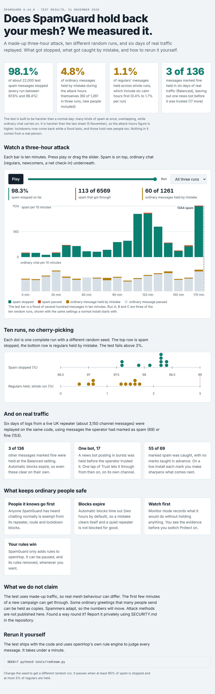

# Tested, with the numbers

For the full suite, coverage and the limits of the testing, see the [test scorecard](test-scorecard.md).

A made-up three-hour attack run ten times with different random seeds, plus six days of real traffic replayed. Nothing in the test comes from a real person, and attack methods are not published.



An interactive version, with a play button and a slider for the timeline, is in [proof-sheet.html](proof-sheet.html). Download it and open it in a browser.

**What the numbers say.** 98.1 percent of about 22,000 test spam messages were stopped, and every run landed between 97.6 and 98.4 percent. During the attack hours about 4.8 percent of ordinary messages were held by mistake (60 of 1,261 over three runs, new people included); the test is harsher than the last one, and lockdowns now return while a flood lasts. Over whole runs, which include six calm hours first, 1.1 percent of regulars' messages were held. Replaying six days of real logs at the Balanced setting caught 55 of 69 messages marked spam and held 20 of 153 marked fine, 17 of them from one news bot before it was trusted.

**What this does not show.** The test uses made-up traffic. The first minutes of a brand-new campaign can get through. New people arriving through a repeater an attack also uses can be held. Spammers adapt, so the numbers will move.

**A fresh install over a week.** A made-up week of the same attacks (three-hour attacks on most days, two on one day, a slow trickle all week) against a stock install, with realistic chat, run on two seeds. A new install starts in Monitor, which stops nothing, and it only switches itself to Protect if no more than three genuine-looking messages would have been held; otherwise it waits for you. With Protect switched on after the first day, 97.5 percent of spam was stopped from then on (about 8,400 messages per run), on both seeds. Ordinary regulars' messages wrongly held were 1.7 and 3.2 percent, the worst being 7 percent on the day with two attacks. New people did worst: more than half were held, because the test has every newcomer say one of four stock greetings and sends about 80 a day, which looks like a copy-paste campaign. Real traffic is much gentler (none of the new people in the replayed logs were held), so read this as the harsh end. The week test is not kept in the repository.

**Run it yourself.** The test is part of the repository and uses openHop's own rule engine to judge every message:

```
SEED=7 python3 tests/redteam.py
```

It passes when at least 90 percent of spam is stopped and at most 3 percent of regulars are held. Found a way round SpamGuard? Please report it privately, as described in [SECURITY.md](../SECURITY.md).
