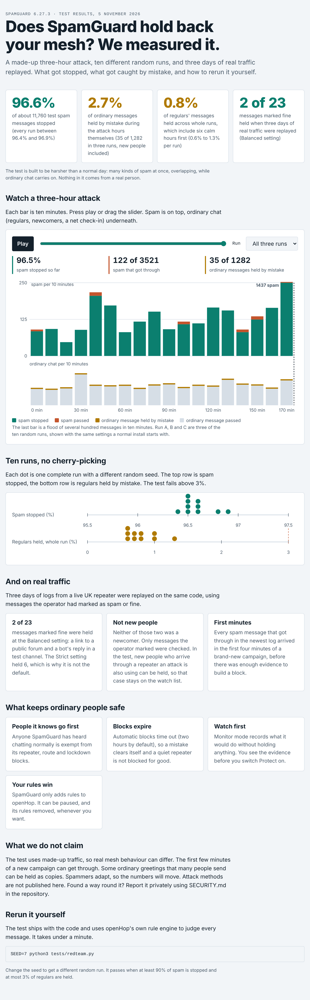

# Tested, with the numbers

A made-up three-hour attack run ten times with different random seeds, plus three days of real traffic replayed. Nothing in the test comes from a real person, and attack methods are not published.



An interactive version, with a play button and a slider for the timeline, is in [proof-sheet.html](proof-sheet.html). Download it and open it in a browser.

**What the numbers say.** 96.6 percent of about 11,760 test spam messages were stopped, and every run landed between 96.4 and 96.9 percent. During the attack hours about 2.7 percent of ordinary messages were held by mistake (35 of 1,282 over three runs, new people included). Over whole runs, which include six calm hours first, 0.8 percent of regulars' messages were held. Replaying three days of real logs at the Balanced setting held 2 of 23 messages marked fine, and neither was from a new person.

**What this does not show.** The test uses made-up traffic. The first minutes of a brand-new campaign can get through. New people arriving through a repeater an attack also uses can be held. Spammers adapt, so the numbers will move.

**Run it yourself.** The test is part of the repository and uses openHop's own rule engine to judge every message:

```
SEED=7 python3 tests/redteam.py
```

It passes when at least 90 percent of spam is stopped and at most 3 percent of regulars are held. Found a way round SpamGuard? Please report it privately, as described in [SECURITY.md](../SECURITY.md).
